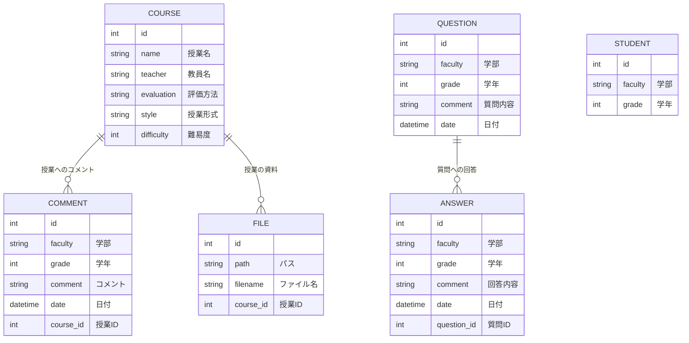

# Kagawa Link 🔗

**香川大学の学生のための授業情報収集アプリ**

先輩の声・授業の難易度・過去の資料を、ひとつの場所で共有・検索できる Web アプリケーションです。

<!-- スクリーンショットを docs/images/ に置いたら、下のコメントを外してください -->
<!--  -->

---

## 📌 開発のきっかけ

授業を選ぶとき、次のような悩みがありました。

- シラバスを見ても、**授業の難易度が分からない**
- **多くの先輩の意見**を聞きたい
- 試験対策のために**過去問がほしい**

こうした「授業の生の情報」を学生どうしで集められる場所を作りたいと考え、開発しました。

## ✨ 主な機能

| 機能 | 内容 |
| --- | --- |
| 📋 **授業一覧** | 授業名・教員名・評価方法・授業形式・難易度を一覧で確認できます。授業ごとに資料ファイルのアップロードにも対応しています。 |
| 💬 **コメント** | 授業ごとに、受講した学生が感想やアドバイスを投稿できます。 |
| ❓ **Q&A** | 授業や学生生活についての質問を投稿し、ほかの学生が回答できます。 |

## 💡 工夫した点

1. **直感的に使える UI** — アイコンなどを用いて、初めてでも迷わず操作できるようにしました。
2. **新しい質問が見つけやすい** — Q&A の質問を日付の新しい順に表示しています。
3. **不適切な投稿を防ぐ** — 不適切な単語をフィルタリングする機能を備えています。

## 🛠 使用技術

| 分類 | 技術 |
| --- | --- |
| 言語 | Python, HTML, CSS |
| フレームワーク | Flask |
| テンプレートエンジン | Jinja |
| ORM / データベース | SQLAlchemy |

### システム構成

```
[ データベース ]  ⇄  [ 処理（Flask） ]  ⇄  [ 入力 / 出力（ブラウザ） ]
   SQLAlchemy          ルーティング・         Jinja で生成した
                       フィルタリング          HTML / CSS
```

### データベース設計



## 🚀 動かし方

```bash
# 1. リポジトリをクローン
git clone https://github.com/<あなたのユーザー名>/kagawa-link.git
cd kagawa-link

# 2. 必要なライブラリをインストール
pip install flask flask-sqlalchemy

# 3. アプリを起動
python app.py
```

ブラウザで http://127.0.0.1:5000 を開くと利用できます。

## 🔭 今後の展望と課題

### 展望

- **ユーザ認証の導入**
  - 自分の投稿と他人の投稿を区別できるようにする
  - 投稿時の学部・学年などの入力を省略できるようにする
- **セキュリティの強化**
  - 香川大学の学生以外による不正アクセスを防ぐ
  - 悪質な誤情報を通報できる仕組みを作る

### 課題

- **著作権への配慮**
  - 教員の許可なく過去問を配布することはできないため、資料共有機能の運用ルールを検討する必要があります。

## 📚 参考資料

開発にあたり、以下の資料を参考にしました（閲覧日：2024年7月）。

**Flask**
- [【Flask】電子掲示板を作る~⑤投稿作成ページを機能させる~](https://shotanukumizu-1000.hatenablog.com/entry/20210906)
- [Flaskで始めるSNSチュートリアル](https://qiita.com/revvve44/items/b91e0a1fc6d5eb9a31c8)
- [Flask ファイルのアップロード](https://msiz07-flask-docs-ja.readthedocs.io/ja/latest/patterns/fileuploads.html)

**HTML / CSS**
- [WebParts-5 メニュー](https://html-css.hamaya2020.com/webparts-5.html)
- [cssを使って画面右下に投稿ボタンを作成する](https://qiita.com/mitsu-0720/items/0a66f1b772f1515b560f)
- [【CSS】おしゃれなボックスデザイン（囲み枠）のサンプル30](https://saruwakakun.com/html-css/reference/box)
- [HTML・CSSで作るログイン画面！初心者でも簡単に実践できる！](https://ui-hack.com/programming/html_css/howtocreate_aloginscreenwithcss/)
- [HTML・CSSのみでつくるアコーディオンメニュー8選](https://pote-chil.com/css-stock/ja/accordion)
- [動くWebデザインアイデア帳](https://coco-factory.jp/ugokuweb/)

**素材**
- [Canva](https://www.canva.com/ja_jp/templates/)
- [icon-pit](https://icon-pit.com/)
- [icooon mono](https://icooon-mono.com/)

**その他**
- [著作権と授業](https://copyright-edu.axies.jp/sugowaka35/use/)

## 👤 作者

吉田 明理
